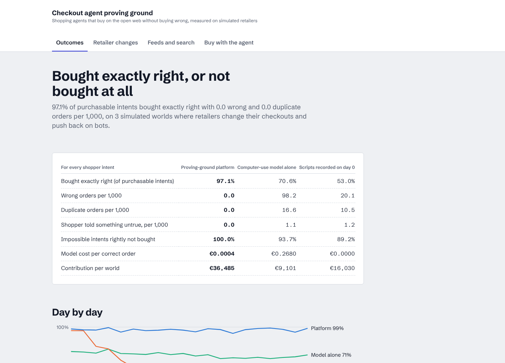
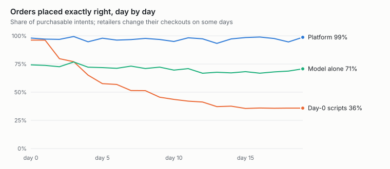
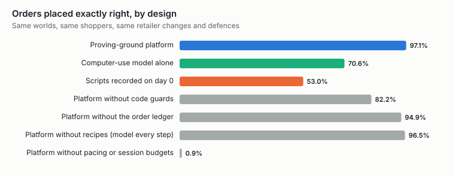

# checkout-agent-proving-ground

Shopping agents that buy on the open web without buying wrong. A computer-use agent completes real-looking
checkouts on retailers that change their pages without warning and push back on bots. It recovers by itself when
a page changes, never pays for the wrong item, size, quantity, add-on or price, never pays twice, and tells the
shopper exactly what happened. Around it are product ingestion that writes and checks its own parsers, and search
over a catalogue whose prices move every day. Everything is measured on a simulated web whose order book the
platform never sees.



## Results

Generated by `python -m cap.eval.cli` from `reports/*.json`; CI re-runs the development evaluation and fails if
this block, the reports or the charts change.

<!-- results:start -->

### Dashboard (development worlds)

| Development | Proving-ground platform | Computer-use model alone | Scripts recorded on day 0 |
|---|---:|---:|---:|
| Purchasable intents bought exactly right | **97.1%** | 70.6% | 53.0% |
| Wrong orders (item, size, quantity, add-on or over budget), per 1,000 intents | **0.0** | 98.2 | 20.1 |
| Duplicate orders, per 1,000 intents | **0.0** | 16.6 | 10.5 |
| Shopper told something different from what happened, per 1,000 | **0.0** | 1.1 | 1.2 |
| Impossible intents correctly not bought (out of stock, over budget) | **100.0%** | 93.7% | 89.2% |
| Handed to the shopper after a human check | **0.0%** | 0.0% | 0.0% |
| Model cost per correct order | **€0.0004** | €0.2680 | €0.0000 |
| Human checks the retailers asked for | **407** | 430 | 469 |
| On-call pages (only the platform has alerting) | **28** | 0 | 0 |
| Contribution per world (commission minus model, mistakes and pages) | **€36,485** | €9,101 | €16,030 |

3 simulated worlds; each has 10 retailers, 6,000 purchase intents over 20 days, 19 checkout changes and 13 feed changes.



### Every design on the same luck

| Design | Exactly right | Wrong / 1,000 | Duplicates / 1,000 | Told wrong / 1,000 | Model € / correct | Pages |
|---|---:|---:|---:|---:|---:|---:|
| **Proving-ground platform** | 97.1% | 0.0 | 0.0 | 0.0 | €0.0004 | 28 |
| Computer-use model alone | 70.6% | 98.2 | 16.6 | 1.1 | €0.2680 | 0 |
| Scripts recorded on day 0 | 53.0% | 20.1 | 10.5 | 1.2 | €0.0000 | 0 |
| Platform without code guards | 82.2% | 149.5 | 0.0 | 0.0 | €0.0348 | 28 |
| Platform without the order ledger | 94.9% | 0.0 | 20.7 | 0.3 | €0.0007 | 28 |
| Platform without recipes (model every step) | 96.5% | 0.0 | 0.0 | 0.0 | €0.1603 | 29 |
| Platform without pacing or session budgets | 0.9% | 0.0 | 0.0 | 0.0 | €0.0379 | 1179 |

| Platform minus | Exactly-right difference (95% interval, paired by intent) |
|---|---:|
| Computer-use model alone | +26.4 points (+25.7 to +27.1) |
| Scripts recorded on day 0 | +44.1 points (+43.4 to +44.8) |
| Platform without code guards | +14.9 points (+14.4 to +15.5) |
| Platform without the order ledger | +2.1 points (+1.9 to +2.3) |
| Platform without recipes (model every step) | +0.5 points (+0.4 to +0.6) |
| Platform without pacing or session budgets | +96.1 points (+95.8 to +96.4) |



### When a retailer changes its checkout

| On the day a retailer changed its checkout | Exactly right that day | On other days |
|---|---:|---:|
| Proving-ground platform | 95.1% | 97.3% |
| Computer-use model alone | 67.5% | 71.0% |
| Scripts recorded on day 0 | 13.5% | 57.0% |

### Ingestion and search

| Ingestion | Wrong prices or stock published | Products missing | Model € per world | Pages |
|---|---:|---:|---:|---:|
| Hand-written parsers | 6.50% | 18.17% | €0.00 | 0 |
| Model reads every item | 1.24% | 0.00% | €21.60 | 0 |
| **Self-checking mappings** | 0.00% | 0.50% | €1.04 | 1 |

| Search | Wanted product in the top 5 | Results above the shopper's budget | Stale prices shown |
|---|---:|---:|---:|
| Keywords, prices from a weekly index | 66.4% | 34.9% | 20.3% |
| Keywords, live prices | 66.4% | 34.9% | 0.0% |
| **Query understanding, live prices** | 79.6% | 0.0% | 0.0% |

Gate (`config/gate.yaml`) on the development worlds: **passed**.

### Held-out worlds (run once)

| Held-out | Proving-ground platform | Computer-use model alone | Scripts recorded on day 0 |
|---|---:|---:|---:|
| Purchasable intents bought exactly right | **97.9%** | 71.3% | 59.1% |
| Wrong orders (item, size, quantity, add-on or over budget), per 1,000 intents | **0.0** | 96.8 | 11.2 |
| Duplicate orders, per 1,000 intents | **0.0** | 21.3 | 15.4 |
| Shopper told something different from what happened, per 1,000 | **0.0** | 1.1 | 1.4 |
| Impossible intents correctly not bought (out of stock, over budget) | **100.0%** | 93.5% | 87.7% |
| Handed to the shopper after a human check | **0.0%** | 0.0% | 0.0% |
| Model cost per correct order | **€0.0003** | €0.2697 | €0.0000 |
| Human checks the retailers asked for | **427** | 450 | 446 |
| On-call pages (only the platform has alerting) | **30** | 0 | 0 |
| Contribution per world (commission minus model, mistakes and pages) | **€37,699** | €9,525 | €19,811 |

| On the day a retailer changed its checkout | Exactly right that day | On other days |
|---|---:|---:|
| Proving-ground platform | 98.0% | 97.9% |
| Computer-use model alone | 64.8% | 71.9% |
| Scripts recorded on day 0 | 26.0% | 61.9% |

Gate on the held-out worlds: **passed**.

<!-- results:end -->

## How it works

| Part | Where | What it does |
|---|---|---|
| Simulated web | `cap/world/` | Retailers with checkouts built from varied vocabularies that change on some days; bot defences (pacing, sessions per hour, human checks, blocks); price rises between cart and review, stock-outs, declined payments, and payments that succeed behind an error page; product feeds in four formats and four price encodings that change without notice; an order book that is the truth |
| Pilot | `cap/agent/pilot.py` | Reads the page as an accessibility tree. Replays recipes by label for pages it knows; calls the computer-use model only for new or changed pages and keeps the repair as the new recipe |
| Guards | `cap/agent/pilot.py` (`Guards`) | Code reads the review page before the one irreversible click: one item line with the right title, size and quantity, no add-on, total within budget, in stock. Unchecks paid add-ons anywhere |
| Ledger | `cap/orders/ledger.py` | One row per intent; an atomic move to `submitting` before paying; after an error page, the order history decides. SQLite in tests, PostgreSQL in CI |
| Engine | `cap/sim/engine.py` | Hours and days of intents with retries, human-like pacing, a session budget per retailer that halves after a challenge, a breaker that pages on-call, hand-offs to the shopper |
| Ingestion | `cap/ingest/pipeline.py` | Finds the rows in any format, asks the model once per source for a field mapping, validates every row (price positive and plausible against yesterday, GTIN check digit, stock value), re-maps a failing source, quarantines it if it still fails |
| Search | `cap/search/engine.py` | BM25 over titles; query understanding turns "under 120 euros" and a size into filters; prices joined at query time |
| Service | `cap/service/api.py` | FastAPI: idempotent `POST /api/orders`, reports, the demo world's retailers and intents; serves the dashboard |
| Dashboard | `web/` | React, TypeScript, Tailwind tokens, Framer Motion: outcomes, retailer changes, feeds and search, and "buy with the agent" on the demo world |

### The designs

| Design | Pilot | Guards | Ledger | Pacing and budgets |
|---|---|:-:|:-:|:-:|
| Scripts recorded on day 0 | element ids from day 0, never repaired | | | pacing only |
| Computer-use model alone | model on every action, checks itself | | | model speed |
| **Proving-ground platform** | recipes by label, model repairs | yes | yes | yes |
| Platform without code guards | recipes, model repairs | | yes | yes |
| Platform without the order ledger | recipes, model repairs | yes | | yes |
| Platform without recipes | model on every action | yes | yes | yes |
| Platform without pacing or session budgets | recipes, model repairs | yes | yes | |

## Run it

```bash
pip install -r requirements-dev.txt
python -m pytest -q                      # seconds
python -m cap.eval.cli evaluate          # the development worlds, about 4 minutes
python -m cap.eval.cli gate
uvicorn cap.service.api:app --port 8080  # API and, after `cd web && pnpm build`, the dashboard

curl -s localhost:8080/api/intents?day=3 | head
curl -s -X POST localhost:8080/api/orders -H 'content-type: application/json' \
  -d '{"idempotency_key": "demo-0001", "intent_id": "<an id from /api/intents>"}'
```

## Tests and CI

- `python`: unit tests (world, guards, recipes, ledger, ingestion, search, service), the ledger's one-payment rule
  with 20 racing workers on PostgreSQL 16, the development evaluation re-run and compared with the committed
  reports, both gates, the held-out lock.
- `web`: the built dashboard against the running service, Playwright with axe on every view, loading, error and
  empty states.
- `image`: the Docker image builds and answers `/health`.

## Limits

- Everything is simulated: retailers, shoppers, defences, payments and feeds. The agent reads an accessibility
  tree, not screenshots, and the computer-use model is a stand-in with error rates written in
  `config/platform.yaml`, not a call to a frontier model.
- The guards depend on review pages that show item lines and a total; a retailer that hides them gets no payment.
- The platform never tries to defeat a retailer's human check; it waits, backs off, and hands the checkout to the
  shopper. Some intents therefore wait an hour or are handed off.
- On-call pages exist only where there is alerting (the platform designs), so the baselines show none.
- Search uses BM25 and rules, not embeddings; it is here for the price-freshness and budget behaviour around a
  catalogue that changes daily.

## Repository guide

`AGENTS.md` has the invariants and the held-out rule; `SKILLS.md` the repeatable tasks; `docs/adr/` the
decisions; `docs/runbooks/` what on-call does when paged.
